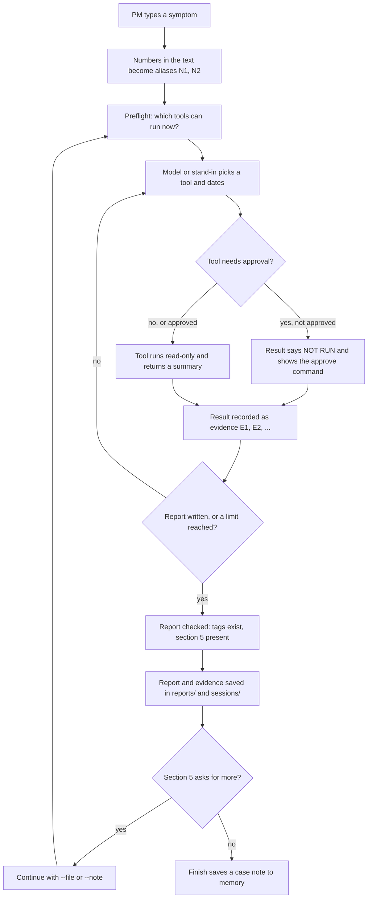

# How it works

## The loop



Step by step:

1. **Start.** `python3 investigate.py "question"` creates a session. Phone numbers in the question are swapped for aliases.
2. **Preflight.** The tool checks which of the seven tools can run now (settings present, database reachable within 3 seconds, numbers given). The model is told which are off and why. It is told to say in section 3 what could not be checked, and in section 5 who can switch it on.
3. **Model turn.** The model chooses one or more tools and dates. The tool layer runs them. Each result gets an id, `E1`, `E2` ... and is sent back.
4. **Repeat** until the model writes a report, or a limit is reached.
5. **Check.** The tool warns if the report cites no evidence tags, cites a tag that does not exist, was cut off, or has no section 5.
6. **Save.** `reports/<id>.md` (report plus all evidence) and `sessions/<id>.json` (conversation and state), scrubbed.

## The report format

Five sections, in this order. The prompt requires it.

| # | Section | Rule |
|---|---|---|
| 1 | Verdict | One line, with confidence |
| 2 | Evidence | Bullets. `[E#]` for tool results, `[U#]` for what you told it. No tag, no claim |
| 3 | Not checked / limits | One line for the failure classes ruled out (with tags). Then only the classes still open or not checkable |
| 4 | Suggested next steps | |
| 5 | Information needed from you | Numbered items: what, why it matters, who or how to provide it. If nothing: `None.` Items you said you cannot get are not asked again |

Aims: under about 700 words; section 5 is written last. These are instructions to the model, **enforced only by the prompt**. The code does not count words or shorten a report. It checks tags and section 5 only.

`inconclusive` is a valid verdict. A date with no log data is "a missing export", never "zero traffic".

## Evidence tags

- `E1`, `E2` ... : tool results, in order. Open `reports/<id>.md` to see each one in full.
- `U1`, `U2` ... : files and notes you added. The report says they are user-provided and unverified.

## The continue loop

When section 5 asks for something, add it and continue:

```bash
python3 investigate.py --continue --file export.csv --note "support says 40 users are affected"
```

- `--continue` resumes the latest session. `--session <id>` picks an older one (`--sessions` lists them).
- `--file` can be repeated. A delivery-log export is copied into `LOGS_DIR`. Other text files (`.txt .md .log .json .csv .tsv`) are masked and clipped.
- You can also drop files into `inputs/` and run `--continue`.
- `--ask` after a report prompts for files and notes right away, so you can keep going in one sitting.
- Numbers from an earlier run are remembered only as fingerprints. To look up user records again, pass `--number` again.
- The model then updates the verdict and writes the full report again.

## Memory and `--finish`

When you are done:

```bash
python3 investigate.py --finish
python3 investigate.py --finish --outcome confirmed --cause "a stuck worker" --yes
```

You choose the outcome: `confirmed`, `probable`, `unresolved` or `discard` (saves nothing). The model drafts a short case note (title, symptom keywords, what it was, first checks, how to tell, what was ruled out). The tool shows it, scrubbed, and saves it only if you answer yes (or pass `--yes`). It is stored in `knowledge/cases.json`, a plain JSON file you can edit or delete.

`python3 investigate.py --knowledge` lists the built-in patterns (labelled `known_pattern`) and your saved cases. In later investigations the most relevant entries go into the prompt as **leads to check first**. The model is told never to state a past cause as the answer because memory says so, and to cite fresh evidence.

## Limits

| Setting | Default | What happens at the limit |
|---|---|---|
| `MAX_STEPS` | 12 | The round stops: "Stopped: step limit of 12 reached before a conclusion." |
| `MAX_SECONDS` | 120 | "Stopped: time limit of 120s reached before a conclusion." |
| `MAX_OUTPUT_TOKENS` | 8000 | The report is flagged as cut off. Run `--continue` for a full one |
| Dates | 14 days per tool call | The tool refuses a longer range |
| Numbers | 20 per investigation | |
| Code-API check | 2 per session, 15 s apart | See [SETUP_CODE_API_CHECK.md](SETUP_CODE_API_CHECK.md) |

To raise a limit, change the setting in `.env`.

## Cost line

After each round the tool prints calls, tokens and an estimated cost from `PRICE_IN_PER_MTOK` and `PRICE_OUT_PER_MTOK`. With `--demo` it prints that no model was used and the cost is 0. The evaluation runner can also cap total spend with the optional `--max-cost` flag (no default cap); see [SETUP_MODEL.md](SETUP_MODEL.md).

## The scripted stand-in

`--demo` replaces the model with `investigator/demo.py`. It picks tools by keywords in your question (for example "queue" or "late" adds `check_message_queue`), always runs `fetch_delivery_logs` first, and fills a template with numbers from the results. It cannot reason, and it can miss anything its rules do not name. Every text it produces starts with `[SCRIPTED STAND-IN, NOT AI]`.

## Where each part lives

See [BUILD_NOTES.md](BUILD_NOTES.md#file-layout).
